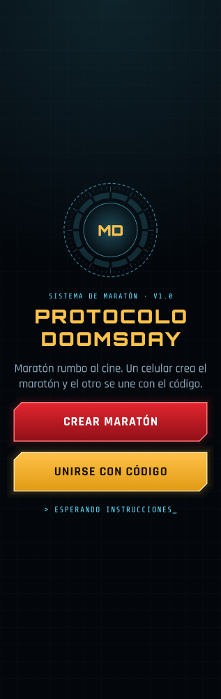
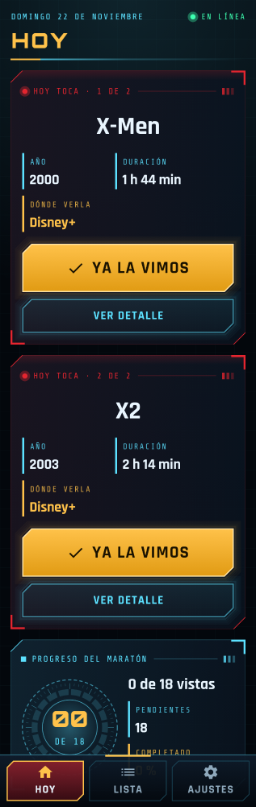
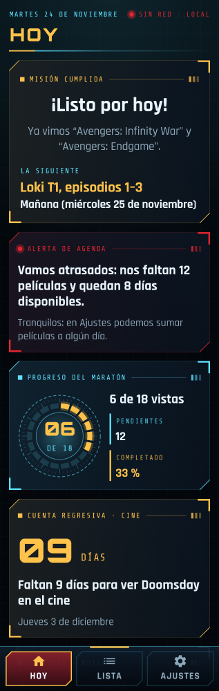
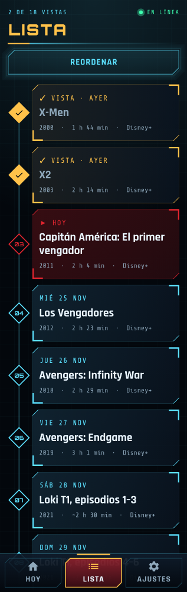
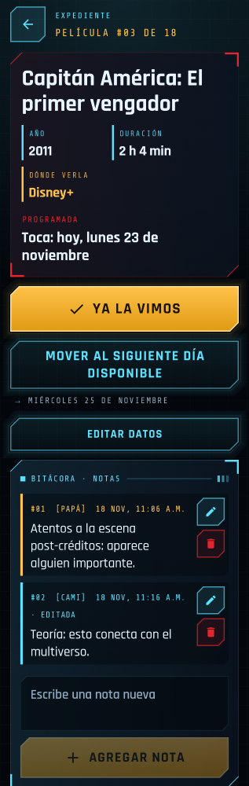
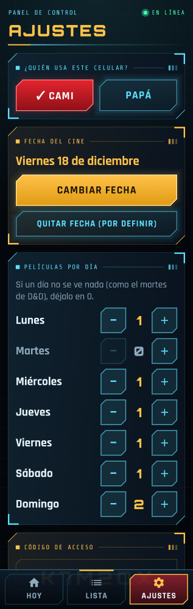

# Maratón Doomsday 🍿🎬

App de Android para llevar el maratón de películas de Marvel rumbo a *Avengers: Doomsday*,
sincronizada en tiempo real entre dos celulares (Cami y Papá).

👉 **Empieza aquí: [GUIA.md](GUIA.md)** — cómo crear Firebase, compilar el APK e instalarlo.

| Inicio | Hoy | Día de descanso | Lista | Detalle | Ajustes |
|---|---|---|---|---|---|
|  |  |  |  |  |  |

- **Hoy**: la película que toca (en grande), botón “✓ Ya la vimos”, progreso, cuenta regresiva al cine y notas.
- **Lista**: todas las películas con su fecha calculada; agregar, quitar y reordenar.
- **Ajustes**: quién eres, fecha del cine, películas por día y código del maratón.
- La agenda se reacomoda sola si un día no se vio la película.

Kotlin · Jetpack Compose · Material 3 · Firebase Firestore (offline) · minSdk 26

Interfaz estilo HUD de laboratorio (paneles con esquinas cortadas, rejilla holográfica, medidor radial).
Fuentes: Rajdhani, Orbitron y Share Tech Mono, bajo licencia SIL OFL (ver `docs/licencias-fuentes/`).
